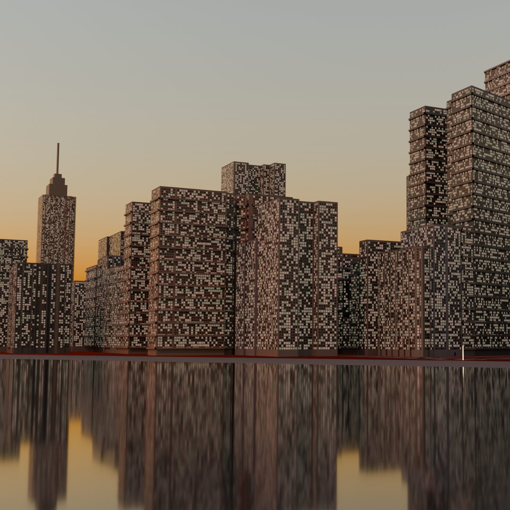
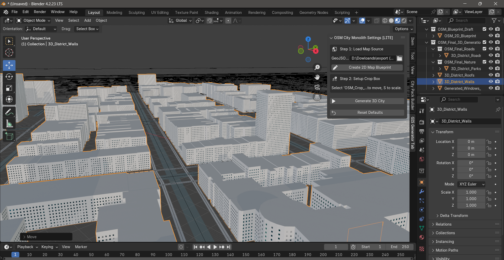

# Instant OSM to 3D Monolith [LITE]

**Instant OSM to 3D Monolith** is a lightweight, fast Blender 4.2+ add-on that converts raw **GeoJSON** map data (from OpenStreetMap / Overpass Turbo) into clean, ready-to-render 3D city geometry in seconds.

## ✨ Key Features (LITE Version)

* **2D Blueprint Preview:** Instantly loads your `.geojson` file and deploys a lightweight 2D wireframe layout centered in World Mercator coordinates.
* **Interactive Crop Box Culling:** Use the `OSM_Crop_Box` to move (`G`) and scale (`S`) your target selection area—generate only the exact district you need without overloading your scene.
* **Procedural Buildings & Windows:** Extrudes building footprints using real OSM `height` or `building:levels` tags (with smart fallback heights), automatically applies Smart UV Project to walls, and generates clean window meshes.
* **Roads & Footways:** Converts highway vectors into 3D road meshes with separate materials for asphalt roads and pedestrian paths.
* **Nature & Water:** Automatically generates flat polygon meshes for parks, forests, meadows, rivers, and lakes.
* **Pre-configured Materials:** Comes with ready-to-use Principled BSDF materials (`OSM_Walls`, `OSM_Roofs`, `OSM_Windows`, `OSM_Road_Asphalt`, `OSM_Footway`, `OSM_Park`, `OSM_Water`).

## 🚀 Upgrade to PRO

Need more control and advanced city details for commercial renders or game environments? Check out the **PRO Version** on Gumroad:
👉 **[Get Instant OSM to 3D Monolith PRO](https://obsidiam.gumroad.com/l/InstantOSMto3DMonolith)**

## 📥 Installation

1. Download this repository as a `.zip` file (click **Code** -> **Download ZIP**) or grab the latest archive from the **Releases** tab.
2. Open **Blender** (version **4.2.0** or newer).
3. Go to **Edit** -> **Preferences** -> **Add-ons**.
4. Click **Install...** (or the top-right dropdown arrow -> **Install from Disk...** in Blender 4.2+) and select the downloaded `.zip` file.
5. Enable **3D View: Instant OSM to 3D Monolith [LITE]**.

## 🛠️ How to Use

1. Export a `.geojson` file of your desired area (for example, via [Overpass Turbo](https://overpass-turbo.eu)).
2. Open the 3D Viewport Sidebar (`N` key) and go to the **GIS Generator Tab**.
3. **Step 1:** Select your `.geojson` file and click **Create 2D Map Blueprint**.
4. **Step 2:** Select the wireframe `OSM_Crop_Box` in the viewport. Move (`G`) and scale (`S`) it to cover the buildings and roads you want to generate.
5. Click **Generate 3D City** and wait a few seconds for your district to appear!

## 📄 License

This project is licensed under the **GNU General Public License v3.0 (GPL-3.0)** — see the `LICENSE` file for details.
